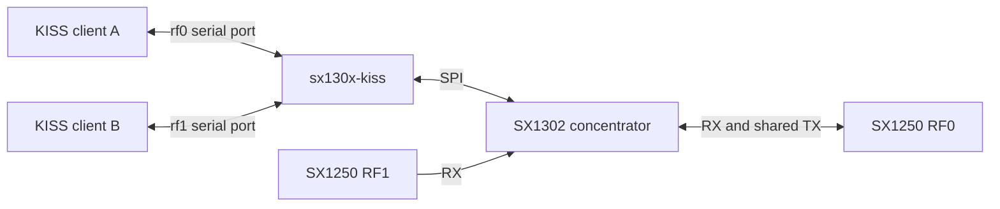

# sx130x-kiss

Turn an SX1302 gateway card into a LoRa radio modem for Linux applications
that speak Mesh KISS, such as openHop Repeater and RepeaterTastic. Connect a
client to either serial port, `rf0` or `rf1`, to listen on its own LoRa profile.

## Will it run on my board?

The current driver needs an **SX1302** with SPI access and **two SX1250 radios**.
The radio tests documented here used a **RAK2287 SPI**. Check the exact module
variant and the frequency band of your antenna and radio card.

| Hardware | What to expect |
| --- | --- |
| RAK2287 SPI | Reference hardware. The driver has received packets on both chains and transmitted on RF0 in bench tests. [Receive tests](driver/README.md#receive-on-both-radios) · [Transmit tests](driver/TX.md) |
| Other SX1302 SPI boards with two SX1250 radios, such as Seeed WM1302 SPI | Candidate hardware. Verify the concentrator reset and the board's RF path on the specific model. [WM1302 hardware guide](https://wiki.seeedstudio.com/WM1302_module/) |
| SX1303 boards such as the RAK5146 SPI | The driver currently accepts concentrator version `0x10`. It rejects boards that report `0x12`. [Version check](driver/sx1250_board.c#L90) |
| USB variants and standalone SX126x or SX127x radios | Require a different transport or driver. |

## Installation

For a published version, choose an installation method for **64-bit Linux**
on ARM or x86. For a checkout, use the source installation below.

| Environment | Install |
| --- | --- |
| Debian 12 or later, including Raspberry Pi OS 64-bit | Download the `.deb` matching `dpkg --print-architecture` from [GitHub Releases](https://github.com/guilhem/rak2287-radio/releases). For an ARM64 package in your download folder, run `sudo apt install ./sx130x-kiss_*_arm64.deb`. |
| Homebrew 6 or later on Linux, glibc 2.36 or newer | `brew install --cask guilhem/tap/sx130x-kiss` |
| Nix 2.30 or later with flakes enabled | `nix profile add github:guilhem/rak2287-radio/nix` |

### Install from source

From the repository root on Linux, use Git, Rust 1.85 or newer with Cargo,
a C compiler, and GNU Make.

```sh
git submodule update --init deps/hal deps/usp
cargo install --locked --path .
```

Run `sx130x-kiss --version` to check the installation. Add Cargo's bin directory
to your `PATH` if you installed from source and the shell cannot find the command.

## Receive your first packet

### 1. Prepare the concentrator

Connect an antenna for the board's band. Enable SPI on the host and check that
your account can read and write the SPI device, usually `/dev/spidev0.0`.
Stop any gateway or modem using that device. Run the reset helper for your
carrier board before starting the modem. [Reset example on the tested carrier](driver/README.md#receive-a-packet)

### 2. Start the modem in receive-only mode

```sh
sx130x-kiss \
  --spi-device /dev/spidev0.0 \
  --runtime-dir "$HOME/.local/run/sx130x-kiss" \
  --mode receive-only
```

The modem creates the private directory and prints the two serial paths.
On a host where your home directory is `/home/pi`, expect this output.

```text
SX130X_KISS_READY rf0=/home/pi/.local/run/sx130x-kiss/rf0 rf1=/home/pi/.local/run/sx130x-kiss/rf1 tx_enabled=0
```

Keep this terminal open. Stop the modem with Ctrl+C to release SPI and remove
its serial links.

### 3. Connect a client

Use a second terminal under the same account. Download the `kisstool` binary
for your Linux architecture from [RepeaterTastic Releases](https://github.com/ScotMesh/RepeaterTastic/releases).
On a 64-bit Raspberry Pi, run these commands from the download folder. On x86-64,
use `kisstool-linux-amd64` in the same commands.

```sh
chmod +x ./kisstool-linux-arm64
./kisstool-linux-arm64 info --dev "$HOME/.local/run/sx130x-kiss/rf0"
```

Look for `SX130x RF0` and `Mesh KISS v2`. The reply confirms the client can
communicate with the modem over the serial port.

To hear an EU868 Meshtastic sender using the Long Fast preset, start a
listener on the same port.

```sh
./kisstool-linux-arm64 listen \
  --dev "$HOME/.local/run/sx130x-kiss/rf0" \
  --region EU_868 --preset LONG_FAST
```

Look for `configured EU_868 LongFast` and `869.5250 MHz, BW 250 kHz` in the
output. Send a packet from a nearby node using that same profile to see
received traffic. For a different sender, select its region and preset or
configure the equivalent LoRa parameters in your application.
[Client commands](https://github.com/ScotMesh/RepeaterTastic/blob/768a030998b8e3cac18e059bb6eb2a73ad4d1dc6/docs/hardware.md#check-the-modem)

## Usage

Run `sx130x-kiss --help` for the full option descriptions and examples.
Every setting has a default, so `sx130x-kiss` alone uses the values below.

| Option | Default | When to set it |
| --- | --- | --- |
| `--spi-device PATH` | `/dev/spidev0.0` | Select the concentrator on a different SPI bus or chip select. |
| `--runtime-dir DIR` | `$XDG_RUNTIME_DIR/sx130x-kiss`, falling back to `$HOME/.local/run/sx130x-kiss` | Choose the private directory for ports without an explicit path. Use an absolute directory owned by the modem account with mode `0700`. The modem creates it when needed. |
| `--rf0-path PATH`, `--rf1-path PATH` | `rf0` and `rf1` in the runtime directory | Set an absolute serial link path for either port. Its parent must already exist, belong to the modem account, and allow writes only by its owner. |
| `--rf0-group GROUP`, `--rf1-group GROUP` | PTY slaves are private (`0600`) | Give the named group read and write access (`0660`) to that port's PTY slave. The modem account needs the group, and the client needs search access to the link's parent directory. Use mode `0711` to keep directory locking exclusive to the modem. |
| `--mode MODE` | `receive-only` | Use `receive-and-transmit` to let clients send through RF0. |

Place shared links where only the modem account or the administrator can
replace their parent directories, as in the systemd setup below.

Before enabling transmission, connect a suitable antenna or load. The connected
application selects frequency and power and schedules airtime within local radio
rules. The modem handles the radio and the send queue.

## Run automatically with systemd

The Debian, Homebrew, and Nix packages include a user unit for systemd 252
or newer. Use it under the same account as the KISS application. Stop any
foreground modem or gateway using SPI before starting the service, then
follow the [carrier reset step](#1-prepare-the-concentrator).

**Debian**

```sh
systemctl --user enable --now sx130x-kiss.service
```

**Homebrew or Nix**

```sh
modem_bin=$(command -v sx130x-kiss)
modem_unit="${modem_bin%/bin/sx130x-kiss}/share/systemd/user/sx130x-kiss.service"
systemctl --user enable --now "$modem_unit"
```

Read the port paths with `journalctl --user -u sx130x-kiss.service -f`.
The packaged unit uses `/dev/spidev0.0`, `%t/sx130x-kiss` (in the user's runtime
directory), and `receive-only`. On a headless host, enable the user manager at
boot with `sudo loginctl enable-linger "$(id -un)"`.

To select another device or runtime directory, run
`systemctl --user edit sx130x-kiss.service` and add a drop-in. This example
selects `/dev/spidev1.0`.

```ini
[Service]
ExecStart=
ExecStart=%Y/../../../bin/sx130x-kiss --spi-device /dev/spidev1.0 --runtime-dir %t/sx130x-kiss --mode receive-only
```

If the carrier needs a reset on every start, add `ExecStartPre=` with the
absolute path and arguments of its reset helper. The modem account must be
able to run that helper. Apply the drop-in with
`systemctl --user restart sx130x-kiss.service`.

After upgrading, run `systemctl --user daemon-reload` and restart the service.
For a Nix profile, first resolve `modem_unit` again as above and run
`systemctl --user reenable "$modem_unit"` so the service follows the new profile
generation. Use `systemctl --user disable --now sx130x-kiss.service` before
removing the package.

### Run MeshCore and Meshtastic under separate accounts

Use this setup on Debian with the `.deb` package, openHop Repeater, and
RepeaterTastic installed as system services. The Debian package provides an
opt-in system unit that runs the modem as `sx130x-kiss` in receive-only mode.
Each client has its own group and serial port.

| Client service | Account | Serial port | Group |
| --- | --- | --- | --- |
| `openhop-repeater.service` (MeshCore) | `repeater` | `/run/sx130x-kiss/rf1` | `sx130x-kiss-rf1` |
| `repeatertastic.service` (Meshtastic) | `repeatertastic` | `/run/sx130x-kiss/rf0` | `sx130x-kiss-rf0` |

If you previously enabled the user unit, run `systemctl --user disable --now
sx130x-kiss.service` under its account. Stop any foreground modem and disable
other services using the concentrator. Create the modem account and port groups,
then check the SPI device permissions. Follow the [carrier reset step](#1-prepare-the-concentrator).

```sh
sudo systemd-sysusers /usr/lib/sysusers.d/sx130x-kiss.conf
stat -c '%A %U %G %n' /dev/spidev0.0
```

If the board grants SPI read and write access to the `spi` group, add this
drop-in with `sudo systemctl edit sx130x-kiss-system.service`. Use your board's
dedicated SPI group if it has a different name.

```ini
[Service]
SupplementaryGroups=spi
```

For carriers that need a reset on every start, add `ExecStartPre=` with the
absolute path and arguments of the carrier's reset helper. Grant any GPIO
permissions it needs to the modem service.

Merge these settings into `/etc/openhop_repeater/config.yaml` for a MeshCore
EU Narrow listener. [openHop KISS configuration](https://docs.openhop.dev/projects/openhop-repeater/config-file/#radio_type-kiss)

```yaml
repeater:
  mode: no_tx
radio_type: kiss
kiss:
  port: /run/sx130x-kiss/rf1
  baud_rate: 115200
radio:
  frequency: 869618000
  bandwidth: 62500
  spreading_factor: 8
  coding_rate: 8
  tx_power: 14
```

This MeshCore profile uses sync word `0x12` and a 32-symbol preamble.

Merge these settings into `/etc/repeatertastic/repeatertastic.yaml` for a
Meshtastic EU868 Long Fast listener. RepeaterTastic opens the KISS port and
uses a local `meshtasticd` 2.8.0 or newer to run its Meshtastic nodes.
[RepeaterTastic configuration](https://github.com/ScotMesh/RepeaterTastic/blob/768a030998b8e3cac18e059bb6eb2a73ad4d1dc6/docs/configuration.md)
· [Meshtastic node setup](https://github.com/ScotMesh/RepeaterTastic/blob/768a030998b8e3cac18e059bb6eb2a73ad4d1dc6/docs/meshtasticd-nodes.md)

```yaml
radio:
  driver: kiss
  device: /run/sx130x-kiss/rf0
  baud: 115200
mesh:
  region: EU_868
  preset: LONG_FAST
  tx_power_dbm: 14
relay:
  role: monitor
```

On its default channel, this Meshtastic profile uses 869.525 MHz, SF11, 250 kHz,
CR4/5, sync word `0x2b`, and a 16-symbol preamble. Match each client's profile
to the senders you want to hear.

Use `sudo systemctl edit openhop-repeater.service` to give openHop access to RF1
and wait for the modem to report that its ports are ready.

```ini
[Unit]
Requires=sx130x-kiss-system.service
After=sx130x-kiss-system.service
PartOf=sx130x-kiss-system.service

[Service]
SupplementaryGroups=
SupplementaryGroups=sx130x-kiss-rf1
PrivateDevices=no
DevicePolicy=closed
```

Use `sudo systemctl edit repeatertastic.service` for RF0.

```ini
[Unit]
Requires=sx130x-kiss-system.service
After=sx130x-kiss-system.service
PartOf=sx130x-kiss-system.service

[Service]
SupplementaryGroups=
SupplementaryGroups=sx130x-kiss-rf0
PrivateDevices=no
DevicePolicy=closed
DeviceAllow=
```

These drop-ins let the clients see the host's `/dev/pts` and restrict direct
hardware access. The modem owns `/run/sx130x-kiss`. Its mode `0711` lets each
client reach its configured link. The group on each PTY slave controls
who can open the port.

```sh
sudo systemctl enable --now sx130x-kiss-system.service
sudo systemctl enable openhop-repeater.service repeatertastic.service
sudo systemctl restart openhop-repeater.service repeatertastic.service
sudo stat -Lc '%a %U %G %n' /run/sx130x-kiss/rf0 /run/sx130x-kiss/rf1
sudo journalctl -b -u sx130x-kiss-system.service -u openhop-repeater.service -u repeatertastic.service
```

Both ports should show mode `660` and the groups in the table. Look for
`SX130X_KISS_READY` with `tx_enabled=0`, openHop's KISS detection on `SX130x RF1`,
and RepeaterTastic's `radio configured` log. A nearby packet on either profile
should appear in its corresponding client. Restarting the modem also restarts
the clients so they reopen the ports. Disable the modem with
`sudo systemctl disable --now sx130x-kiss-system.service` before removing the package.

## Connect your own application



Open one client per serial device at 115200 baud using KISS port number `0`.
Each client sends `SetRadio` to receive packets on its port and reapplies its
profile after a modem restart. With transmission enabled, a frame from either
port goes out through RF0 with that port's settings. Both receivers pause
during transmission and resume afterward.

[KISS commands and transmit behavior](docs/kiss.md) · [C driver and bench results](driver/README.md)

## Troubleshooting

| Symptom | What to check |
| --- | --- |
| SPI device missing | Enable SPI and select the device path for your concentrator. A card with an unsupported concentrator revision can also fail at open. |
| SPI permission denied | Use `ls -l /dev/spidev0.0` to check device permissions and ensure the modem account has read and write access. |
| Device or runtime directory busy | Stop the other process that owns SPI or the serial ports. Use the carrier's reset helper before reopening SPI after stopping gateway software. |
| Runtime directory rejected | Use an absolute path with a private directory owned by the modem account. Choose another path if the existing entry is a symlink or is owned by another account. |
| Explicit port path rejected | Check that its existing parent directory belongs to the modem account and only the owner can write to it. |
| Explicit port path occupied | Choose a free path. If the modem left an old link after an unclean stop, confirm that the link belongs to that stopped instance before removing it. |
| Client cannot open a shared port | Use `stat -L` to check the PTY slave's group and mode. Check the client's systemd `SupplementaryGroups`, whether its service can see the host's `/dev/pts`, and whether the modem reports ready. |
| Client replies to `info` but sees no frames | Apply a receive profile with the client. Match the card's band, frequency, spreading factor, bandwidth, coding rate, sync word, and preamble to the sender. |

## Try it without a board

From the repository root on Linux, use Rust with Cargo and a C compiler.
The simulator opens serial ports using a simulated SPI device.

```sh
cargo run --locked --no-default-features --features sim -- \
  --spi-device /simulated-spi \
  --runtime-dir "$HOME/.local/run/sx130x-kiss-sim" \
  --mode receive-only
```

Use the [same client binary as above](#3-connect-a-client) on the simulated port.
The following command queries the simulated port from the download folder
on x86-64.

```sh
./kisstool-linux-amd64 info --dev "$HOME/.local/run/sx130x-kiss-sim/rf0"
```

Use `make kiss-check` with Python 3 to run the automated tests. With the two
radio submodules initialized, `make kiss-driver-check` exercises the production
driver against a simulated HAL. For the full `make check` suite, initialize all
submodules and install a C++ compiler.

[Build packages and publish a release](packaging/RELEASING.md)

## License

[BSD 3-Clause](LICENSE) · [Third-party notices](NOTICE.md)
